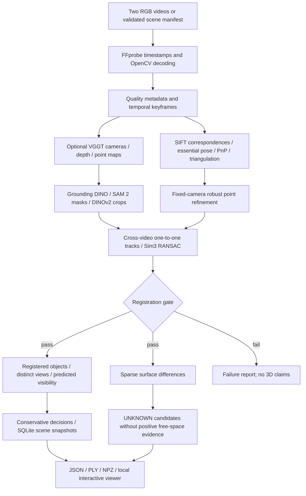

# Architecture and implementation boundary

`inputs.py` defines canonical Pydantic contracts and path boundaries. `ingestion.py` reads originals without modification, extracts original presentation timestamps and records hashes. Keyframes are selected by feature quality, duplicates and temporal spread. Temporal spread is a proxy, not verified viewpoint diversity. All input frames remain available from the source and timestamp index.

`geometry.py` uses camera-to-image projection `u ~ K [R|t] X`. Stored poses are `T_camera_world`; camera centers are `-R.T @ t`. OpenCV coordinates are X right, Y down, Z forward. If calibration is supplied, its dimensions rescale intrinsic parameters, and OpenCV distortion is corrected before features. Rotated recordings require calibration in the decoded orientation; automatic rotation of calibration is not implemented. Default focal length is heuristic; calibrated self-estimation remains future work.

`registration.py` estimates `X_before = scale * R * X_after + t` using matched 3D tracks. Degenerate sample geometry is rejected. Minimum inliers and ratio gate decisions. Detected foreground masks exclude feature matches before fitting. For sufficient matches, a seeded correspondence subset is held out and must pass its own inlier gate before refitting all matches. This is not independent scene-level validation, statistical covariance or a metric guarantee. ICP is intentionally not performed blindly on potentially changed sparse surfaces.

`change.py` clusters unsupported surfaces. Sparse geometry is insufficient for free-space observations, so the integrated baseline returns UNKNOWN candidates. An independently testable classifier can return ADDED/REMOVED only with explicitly supplied positive free-space evidence; MOVED requires verified identity and displacement beyond an uncertainty band. The optional semantic profile computes appearance associations and registered predicted-depth visibility; these carry separate model-prediction provenance and conservative gates.

`visibility.py` compares projections against measured, registered depth: occupied, free, occluded or unknown. It must receive common-frame camera poses and consistent depth scale. The semantic profile separately uses VGGT depths and cameras from the same reconstruction for predicted occupied/free/occluded evidence. Predicted free space supports only probable labels; it is never relabeled measured or metrically calibrated.

`evidence.py` combines caller-supplied log-likelihood ratios in log-odds space, averaging within correlation groups. This avoids counting duplicate observations repeatedly. No posterior is invented by default. `calibration.py` can fit Beta-Bernoulli signal rates from supplied labeled correlation groups; training intervals and provenance are saved. Such a posterior remains unvalidated for deployment without held-out real measurements. Adaptive ranking is a bounded quality/viewpoint novelty heuristic, not measured information gain.

`memory.py` preserves observations and immutable scene snapshots separately in SQLite. Identity assignment uses appearance and class costs, with row and column alternatives preserved for identical objects. The scene graph currently supports geometrically derived NEAR only. `tracking.py` implements forward/backward LK consistency and homography compensation; residual motion is not classified as physical movement. `navigation.py` plans an experimental 4-connected grid route with unknown cells blocked; it is not yet driven by reconstructed floor geometry.

`models.py` contains local Transformers experts for DINOv2, Depth Anything V2 and Grounding DINO, and a VGGT adapter for separately installed official code/local weights. These experts plus pinned official SAM 2 image segmentation passed actual pretrained CPU inference on synthetic inputs. `neural_geometry.py` converts VGGT outputs to the common Reconstruction interface with raw-confidence-filtered image keypoints, preserved model predictions and pinned source/checkpoint provenance. The optional vggt backend executes the same cross-video registration gate and conservative change comparison as sparse geometry. No model is silently substituted for a failed expert.

`app.py` runs one worker and reports actual stages. Its local canvas displays measured point arrays and camera centers without external JavaScript or model APIs. It displays computed object extents, decision explanations, actual mask evidence, immutable scene snapshots, semantic relationships and held-out registration diagnostics. Benchmark accuracy remains unavailable without real ground truth.

No plugin currently supplies missing weights, sensor measurements, annotations or actual recordings. No distributed execution, calibrated consensus, dense TSDF, SLAM loop closure, SAM 2 video-memory tracking or automatic partial-stage resume are claimed.

`semantics.py` connects Grounding DINO regions, `segmentation.py` box-prompted SAM 2 masks, masked DINOv2 crops and per-frame geometry. Grouping uses appearance and spatial proximity while preserving identical-object ambiguity. Independent views require angular camera-center separation, rather than repeated-frame counts. Registered object extents and depth projections gate MOVED / UNCHANGED / ADDED / REMOVED / UNKNOWN. Centroid spread is observed dispersion, not calibrated uncertainty. Raw model scores are retained without interpreting them as correctness probabilities. SQLite keeps observation records and both scene snapshots. Dense forward/backward optical flow checks mask continuity; a fresh SAM image mask remains the primary evidence.

The optional geometry cache validates video hashes, configuration, pinned VGGT provenance, finite prediction shapes and exact normalized source frames. `execution.py` holds a nonblocking output lock. Failed stages retain failure diagnostics and do not fabricate successful artifacts.
