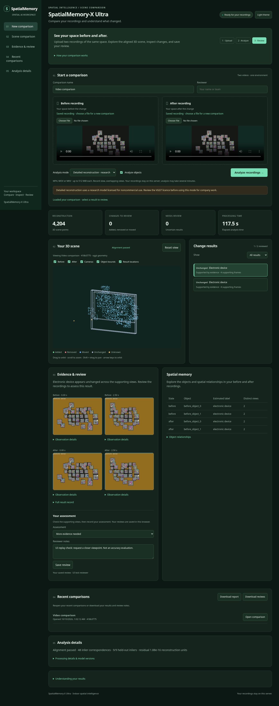

# SpatialMemory-X Ultra

[References and related work](docs/REFERENCES_AND_RELATED_WORK.md)

Compare two recordings of the same indoor area, reconstruct a shared 3D scene, and inspect model-proposed changes with supporting frames and uncertainty.

[](https://colab.research.google.com/github/VamshiKrishnaBandari07/Spatial-AI-system-for-Humanoid-Robotics/blob/main/notebooks/SpatialMemory_Colab.ipynb)



**Latest validation and submission:** [review the measured results and limitations](docs/SUBMISSION.md). Fresh phone-video inference completed in 16 min 33 sec; 53 decisions remained inconclusive, with zero confirmed changes. The dense 3D export contains 59,732 points in unverified units.

**Status:** operational research prototype. Reliable cross-session object association, calibrated uncertainty and genuine smartphone change-detection accuracy remain unresolved. UNKNOWN means insufficient evidence, not an unchanged object. The screenshot shows a synthetic demonstration.

Recent camera-adjustment and learned-correspondence trials preserved the
strict geometry gates but did not confirm changes on the submitted phone pair.
See [measured experiments](docs/CORRESPONDENCE_EXPERIMENTS.md) for model
provenance, reproducible options and remaining failures.

## Try the upload workspace

Open the Colab notebook above. Read the model licence notice, run Step 1 until installation finishes, then run Step 2. Choose a password and open the generated temporary link; sign in as `reviewer`. Upload separate before and after videos and select **Neural + objects**.

The existing loaders use CPU even if a GPU runtime is selected. Free Colab memory and session availability are not guaranteed. Save `results.zip` before disconnecting. See [Colab instructions](docs/COLAB.md) and [recording guide](docs/PHONE_DEMO.md).

## Implemented pipeline

| Stage | Current implementation |
|---|---|
| Inputs | RGB MP4/MOV/MKV; typed manifests and optional sensor metadata; original presentation timestamps, orientation and input hashes |
| Frame selection | Quality, feature coverage, duplicate checks and temporal diversity; independent viewpoints checked separately |
| Reconstruction | Pinned VGGT neural depth/cameras/point maps, or explicitly selected sparse geometry baseline |
| Alignment | Foreground-excluded Sim(3) correspondence RANSAC; phone profile requires held-out checks; approved RGB-D workflow uses sourced native alignment and gated ICP |
| Objects | Grounding DINO detection, SAM 2 image masks and masked DINOv2 descriptors |
| Association | Multi-cue one-to-one assignment, explicit unmatched options and ambiguity rejection |
| Evidence | Viewpoint diversity, occupied/free/occluded/unknown reasoning and conservative consensus |
| Memory | Persistent observations, object histories and scene snapshots |
| Delivery | Interactive 3D/evidence viewer, JSON, PLY, diagnostics and results ZIP |

No model is silently substituted after inference fails. Unreliable registration stops processing. Bounded movement abstains without validated depth/alignment error budgets. Ranking scores and predicted mask IoUs are not calibrated probabilities.

Small-object evidence uses the original point-confidence filter plus confidence-filtered depth-head support when both geometry heads agree. Visibility follows the same support policy. These heads share a neural model; agreement is not independent verification. The broader indoor vocabulary covers cups and toiletries, but detection does not establish object identity or removal. See [evidence-processing review](reports/object_evidence_repair.json).

Full MASt3R/COLMAP integration, SAM 2 video-memory tracking, dense TSDF fusion, grounded language-model explanations and validated robot navigation remain research extensions. See [architecture](ARCHITECTURE.md) and [methodology](docs/METHODOLOGY.md).

## Local installation

Python 3.12 on Linux is the validated environment. Install FFmpeg and ffprobe first.

```bash
python3 -m venv .venv
.venv/bin/python -m pip install -r requirements/cpu.lock.txt
.venv/bin/python -m pip install --no-build-isolation --no-deps -e .
.venv/bin/python -m pytest -q
```

Activate the environment for subsequent commands. This prepares the baseline and regression suite; neural checkpoints are separate. In the original cloud checkout, `scripts/install_neural.sh` installs pinned CPU dependencies and verified source/checkpoints under `/workspace`. On Colab, use the notebook setup cell. Inspect these paths before using them on another machine.

```bash
python -m uvicorn spatialmemory.app:app --host 127.0.0.1 --port 8000
```

The local service processes one job at a time and accepts up to 512 MiB per video. It is not an authenticated multi-user deployment. The Colab wrapper adds temporary password-protected access. Human review notes remain separate from predictions and ground truth.

Both UIs offer optional frame tracking with real neural re-detection. This is
additional CPU work and produces uncalibrated 2D track proposals, per-frame
diagnostics and observation crops; it does not establish physical removal.
Neural geometry now defaults to `neural_preprocessing: "pad"` to preserve the
whole image, including objects near portrait-frame edges. Explicit `"crop"`
remains available for reproducing older runs. See
[methodology](docs/METHODOLOGY.md) for coverage, padding and tracking limitations.

## Command-line processing

For experimental native crop refinement, checked camera recovery and robust
object triangulation, use `--config configs/phone_multiview.json` or select
**Multi-view object analysis** in the UI. See
[multi-view refinement](docs/MULTIVIEW_REFINEMENT.md) for strict geometry gates,
calibration requirements and current validation limits. This option does not
guarantee detection of every object or change.

For the new gated 3D/ReID matcher and temporal EMA gallery, use
`--config configs/phone_identity.json`. See
[identity association](docs/IDENTITY_ASSOCIATION.md) for cost definitions,
checkpoint APIs, ambiguity handling and validation limits. Existing UI defaults
continue to use the previous association mode.

```bash
python -m spatialmemory_x run --before before.mp4 --after after.mp4 --scene-id room_01 --output results/room_01
python -m spatialmemory_x run --before before.mp4 --after after.mp4 --scene-id room_01 --config configs/phone_challenge.json --output results/room_01_neural
python -m spatialmemory_x run --manifest examples/scene_manifest.json --project-root .
```

Neural runs require the installed source/checkpoints. Example manifests contain placeholder paths. `run` does not require annotations. Manifest paths resolve against the project root; direct video paths are explicit. Completed output directories are immutable; choose a new directory for each comparison.

Outputs include scene clouds, change records, supporting frames, exact association/visibility gates, model provenance and processing diagnostics. Failed stages produce `failure.json`; partial stages are not automatically resumed. Monocular distances remain reconstruction units unless metric scale is verified.

## Validation and measured limitations

- Latest independent phone pair: fresh neural inference completed in 826.27 seconds and exported an aligned 3D scene, but all 53 decisions were inconclusive. No added, removed or moved objects were confirmed. [Run report](reports/room_submission_002.json) records the configuration, alignment measurements and blocking gates. This prototype does not yet satisfy reliable change-detection acceptance.

- A fresh application control invoked VGGT, Grounding DINO, SAM 2 and DINOv2 on identical real-dataset RGB recordings. It completed in 322.41 seconds with 48 UNKNOWN decisions and no confirmed changes. This is execution evidence, not change-detection accuracy.
- One approved 3RScan reference/rescan pair completed source-assisted metric alignment: RMSE approximately 0.03346 m, held-out RMSE 0.03970 m, symmetric overlap 0.4861. This does not establish autonomous phone-video alignment.
- The partial native-source evaluation contains one supported MOVED instance, which was missed: restricted recall/F1 0; precision undefined. Full independently reviewed benchmark metrics remain unavailable.
- A user-confirmed animated example completed fresh neural inference with 25 UNKNOWN decisions. Its alignment had no held-out correspondences; the stricter phone profile now rejects such insufficient validation.

Regression tests verify implementation behavior; they do not measure real-world accuracy. Read [application verification](reports/APPLICATION_VERIFICATION.md), [3RScan validation](docs/3RSCAN_VALIDATION.md), [evaluation](EVALUATION.md) and [repository review](reports/repository_review.json) for scope and results.

For a genuine benchmark, provide independent same-room recordings, verified object identities and change labels, unchanged/occluded examples, and held-out calibration data. Follow the [annotation protocol](docs/annotation_protocol.md); never copy model suggestions into ground truth.

## Data and licences

Approved 3RScan data, ARKitScenes and 7-Scenes subsets have verified local files; raw data is not included in a clone. Ordinary RGB-D sequences are reconstruction/localization controls, not automatically changed-scene ground truth. Replica remains a partial appearance asset. See [dataset access](docs/DATASET_ACCESS.md) and [quality report](reports/dataset_quality_report.md).

Project-authored code uses [MIT](LICENSE). Third-party models and datasets retain their own terms. The selected VGGT research checkpoint is noncommercial; company evaluation or deployment rights must be verified separately. No weights, restricted recordings or credentials are redistributed. See [model registry](MODEL_REGISTRY.md).

## Optional visual-language comparison

A separate [multi-view visual comparison stage](docs/VISUAL_COMPARISON.md) can submit sampled before/after frames to a vision-language API and save evidence-linked visual change proposals. It requires an API credential, is not yet connected to the upload UI, and does not certify 3D changes. Live model accuracy has not been validated.

## GitHub-hosted workspace

The `site/` interface provides private browser video previews, local JSON report review, and a Colab analysis launcher. See [hosting instructions](docs/HOSTING.md) to enable GitHub Pages and run the deployment workflow. GitHub Pages does not host model inference; live publication has not been verified from this environment.

## Local visual-language backend

A [local SmolVLM backend](docs/LOCAL_VISUAL.md) now provides optional multi-image descriptions in the FastAPI dashboard without an API key. Install its pinned checkpoint and enable `SPATIALMEMORY_VISUAL_BACKEND=local`. Generated descriptions are unverified observations, not confirmed 3D changes.
